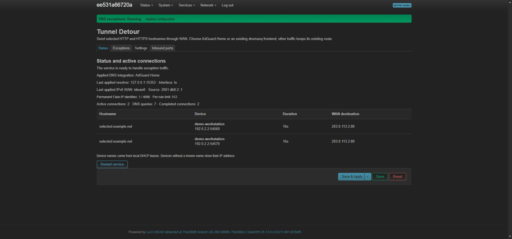
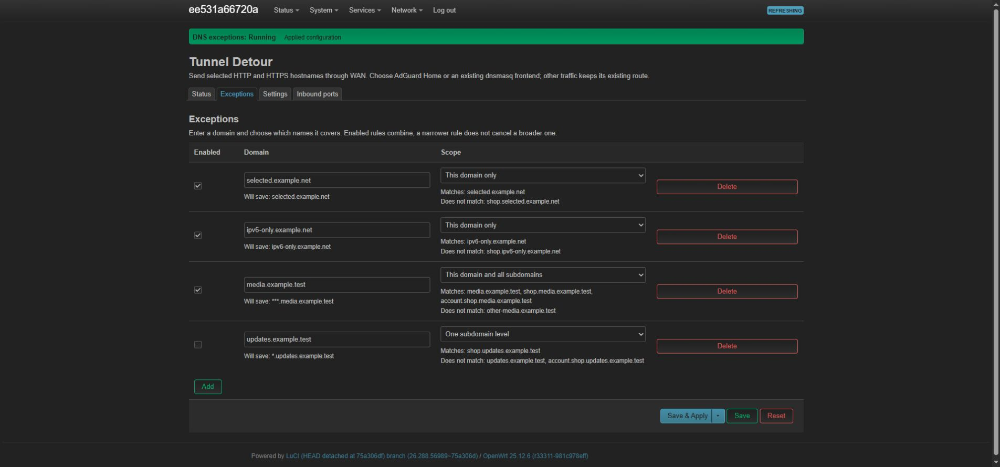
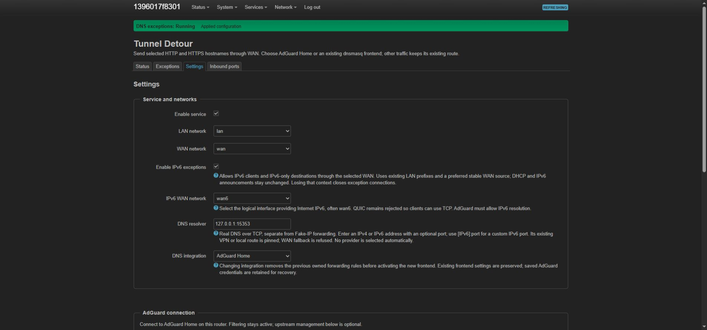
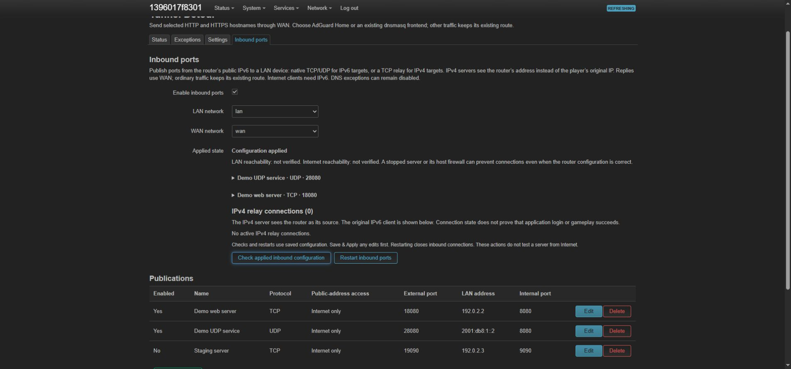

# Tunnel Detour

Current source version: **0.2.0**. See [CHANGELOG.md](CHANGELOG.md) for the version notes.

Domain-based VPN exceptions for OpenWrt, implemented in Rust, with optional AdGuard Home integration. Selected HTTP and
HTTPS connections use WAN through DNS Fake-IP mappings and a transparent TCP relay. Other traffic
keeps its existing route. LuCI manages one exception list and its forwarding rules automatically,
using either AdGuard Home or an existing dnsmasq frontend. TLS passes through without decryption.

The initial target is OpenWrt One with OpenWrt 25.12.6, firewall4/nftables and APK packages.
Exceptions support TCP ports 80 and 443, with IPv4 compatibility mode and optional IPv6,
including IPv6-only destinations. QUIC is rejected to allow TCP fallback; HTTP/3 remains deferred.
Exception traffic fails closed when its path is unavailable.

Exception clients must use the configured DNS frontend and normal hostname validation.
Fake-IP preserves DNS hostname identity; it does not authenticate an HTTP Host header or the
hostname inside opaque TLS. Treat the selected LAN as trusted, or restrict **Trusted exception
clients** to IPv4/IPv6 CIDRs within it. This is not a boundary against a malicious authorized client.

## LuCI interface

Status shows service health and active connections. Exceptions provides per-rule validation, match
examples and undo before saving. Settings groups network selection and the DNS integration;
AdGuard credentials and its connection test appear only when that integration is selected.
Credentials are write-only in LuCI and stored outside UCI in a root-owned private file.
Upgrade/startup migrates legacy credentials; leave both fields empty to retain them, or use the
explicit anonymous-authentication option. Save prepares one private draft; its nonsecret UCI revision selects it
on apply, and discarding UCI changes retains the applied credentials. A superseded draft fails
closed. A read-only LuCI session cannot retrieve or replace stored credentials.

Inbound ports manages publications independently of DNS exceptions. See
[Inbound ports](#inbound-ports) for target address families, DHCP and setup.

Screenshots use an isolated demo with synthetic domains, addresses and connection data.



<details>
<summary>Exceptions, settings and inbound ports</summary>







</details>

## Inbound ports

Internet clients connect to the router's public IPv6 address. Replies use WAN while ordinary
traffic keeps its existing route. This feature works with DNS exceptions disabled; enabling
**IPv6 exceptions** in Settings is not required for inbound publications.

| LAN server address | Supported transports | Forwarding path |
| --- | --- | --- |
| IPv6 | TCP, UDP or both | Native IPv6 forwarding |
| IPv4 | TCP | IPv6-to-IPv4 TCP relay |

For an IPv4 server, the publication must contain its IPv4 address. Entering an IPv6 address
selects native IPv6 forwarding. The IPv4 server sees the router as its source; LuCI shows the
original IPv6 client in the active relay connections.

1. Reserve the server's LAN address in OpenWrt's native DHCP page, or use an existing stable
   address. Tunnel Detour does not create or edit DHCP reservations. Neighbor suggestions do
   not establish address stability.
2. Open **Inbound ports**, enable the feature and select the LAN and WAN networks.
3. Add a publication with the protocol, external port, LAN server address and internal port.
   Choose **Internet only**, or explicitly allow **Internet and LAN** access to the public address.
4. **Save & Apply**, then run **Check applied inbound configuration**. Test with the server
   listening, including a connection from an independent external IPv6 network.

Internet-and-LAN access keeps local connections on LAN and presents the router's source
address to the server. Connection, connect-timeout and inactivity limits are configurable.
At capacity, up to 32 extra ingress connections wait at most 250 ms for a slot.
Ports occupied by other router services are refused, with their known use displayed.
Replacing this package's own publications requires confirmation and retains their disabled
settings; applying changes closes affected connections.

Back up existing manual forwarding and routing settings before migrating them. Conflicting
redirects require explicit migration; Tunnel Detour does not automatically adopt unrelated rules.
Applied state and successful LAN access do not prove Internet reachability. Software flow
offloading remains enabled across edits; hardware acceleration and full device acceptance
remain separate validation work.

## Domain rules

| Rule | Matches |
| --- | --- |
| `example.test` | The exact hostname |
| `*.example.test` | One subdomain level |
| `**.example.test` | All subdomain levels, excluding the root |
| `***.example.test` | The root and all subdomain levels |

Rules combine. Adding a narrower rule does not cancel a broader one.

## Configuration

The packages are named `tunnel-detour` and `luci-app-tunnel-detour`. Neither DNS frontend is
installed automatically. Choose the frontend already serving your LAN:

- **AdGuard Home:** configure its router-local API access. Existing filtering, client policies
  and local names are preserved. API failure never selects another integration automatically.
- **Existing dnsmasq:** requires one running standard OpenWrt instance. Tunnel Detour owns only
  domain-specific forwards; DHCP, local names and unrelated upstreams remain with dnsmasq.
  Custom filters, extra configuration files, DNSSEC and overlapping local or conditional rules
  are rejected rather than bypassed. Aliases and cached connections are rechecked before WAN.

New installs are disabled and require an explicit integration choice. Existing configurations
without a selector keep using AdGuard Home. Configure LAN/WAN networks and a separate real DNS
resolver, add exceptions, then enable the service. The real resolver uses DNS over TCP to a
literal IPv4 or IPv6 endpoint and must avoid the frontend's Fake-IP path. Use `[IPv6]:port`
for a custom IPv6 port; omitting the port selects 53. Its existing VPN or local interface is pinned;
WAN fallback is refused. No DNS provider or fallback is selected automatically.
IPv6 resolver paths require loopback, the selected LAN or a native WireGuard device.

For IPv6 exceptions, enable the option in Settings and select the IPv6 WAN network. It requires
existing usable LAN prefixes and a preferred global WAN source; DHCP and IPv6 announcements
are not changed. Status shows the applied device/source. Both address families share one
per-hostname lease, and losing its LAN or WAN context closes exception connections.
Compatibility mode suppresses AAAA and rejects cached synthetic IPv6 addresses.

Direct same-host HTTPS ServiceMode records retain supported TCP parameters and use synthetic
address hints with bounded TTLs. HTTP/3 ALPN is removed. Alternate targets, aliases, unsupported
ports, ECH and unknown or unavailable mandatory parameters retain empty answers. SVCB queries
for selected hostnames and port-qualified HTTPS records stay suppressed; this is a limited HTTP
mapping, not general SVCB or ECH support. Ordinary hostnames retain their upstream DNS records.

AdGuard upstream management is optional. Preview the proposed general upstream or explicitly
import its current TCP resolver, then accept and Save & Apply within ten minutes. Tunnel Detour
keeps a recoverable baseline, preserves bootstrap and conditional settings, and audits for
conflicting edits. AdGuard has no conditional-write API: use Tunnel Detour as the only upstream
editor while this option is enabled. Detected conflicts require a fresh review. Resolver changes
preserve established TCP streams and Fake-IP mappings. System DNS, DHCP and IPv6 announcements
remain outside this setting.

Changing integration first checks the replacement, then removes the previous owned forwards.
If cleanup fails, recovery state is retained and activation fails closed. Keep the old frontend
and its API available until the transition completes. Inactive AdGuard credentials remain in
private configuration for recovery; disabling or uninstalling removes owned forwards and restores
an adopted general upstream only while its ownership is still provable.
After activation, `/etc/nftables.d/tunnel-detour-cache-guard.nft` protects cached synthetic
addresses across stops and reboots, including failed service startup. Uninstall removes
this file and its firewall guards.
Synthetic answers are not DNSSEC authenticated.

New hostname allocations default to 512 permanent identities per matching rule and 4096 total.
Settings exposes both budgets and Status shows occupancy. Expiry never releases an identity;
known hostnames can renew when a budget is full. The most specific matching rule owns admission,
and its budget counts all stored names it matches, including expired entries.

The controller retains privileges for DNS policy and OpenWrt configuration. Each opaque TCP
transport runs as the platform's `nobody` user in an empty private filesystem root, with no
supplementary groups, no effective capabilities and no privilege escalation through exec.
The controller passes only the authorized connected sockets, supervises cancellation and reaps
the process. Unexpected inherited descriptors refuse the connection. An architecture-checked
seccomp allowlist denies new network sockets, process signals, filesystem access and process
creation; its installation is required. Anonymous local socket pairs are allowed for Tokio's
wakeup mechanism. Both independent features reuse one empty runtime root, avoiding directory
growth after hard crashes; uninstall removes it. This isolates copying; DNS parsing and policy
remain in the privileged controller.

## Development

Use Rust 1.96. Network laboratories require Linux and Docker; APK builds require the
OpenWrt 25.12.6 mediatek/filogic SDK and the `aarch64-unknown-linux-musl` Rust target.

```sh
cargo fmt --all -- --check
cargo test --workspace --locked
cargo clippy --workspace --all-targets --all-features --locked -- -D warnings
cargo xtask package --sdk /path/to/openwrt-sdk
```

APKs, source SBOM, build metadata and checksums are written to
`target/packages/mediatek-filogic/`. Run `cargo xtask` for laboratory and benchmark commands.
Network tests use isolated laboratories; real-router tests require separate SSH authorization.
The [requirement coverage map](sources/tests/requirements.md) identifies the owning tests.

## License

The project's original code is licensed under the GNU General Public License, version 3 only
(`GPL-3.0-only`). See [LICENSE](LICENSE) for the full terms.
